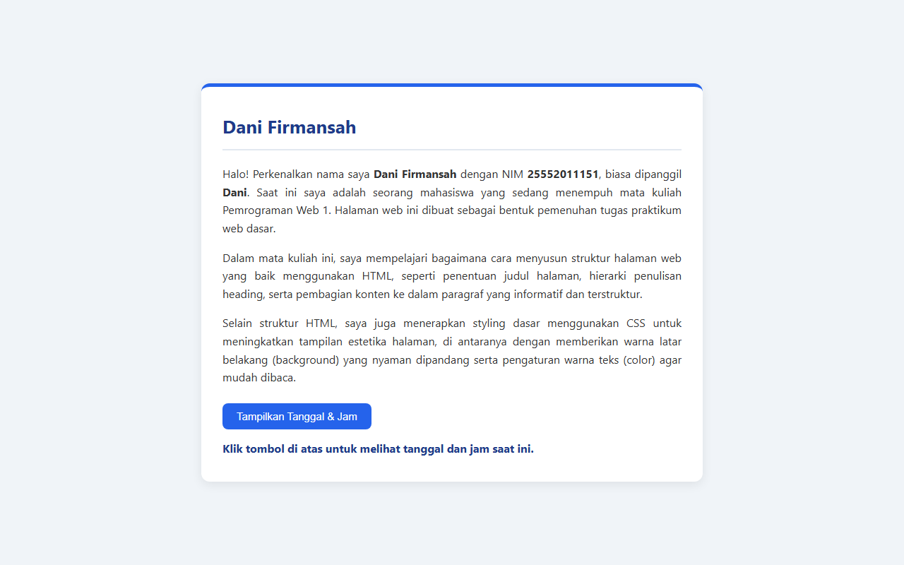
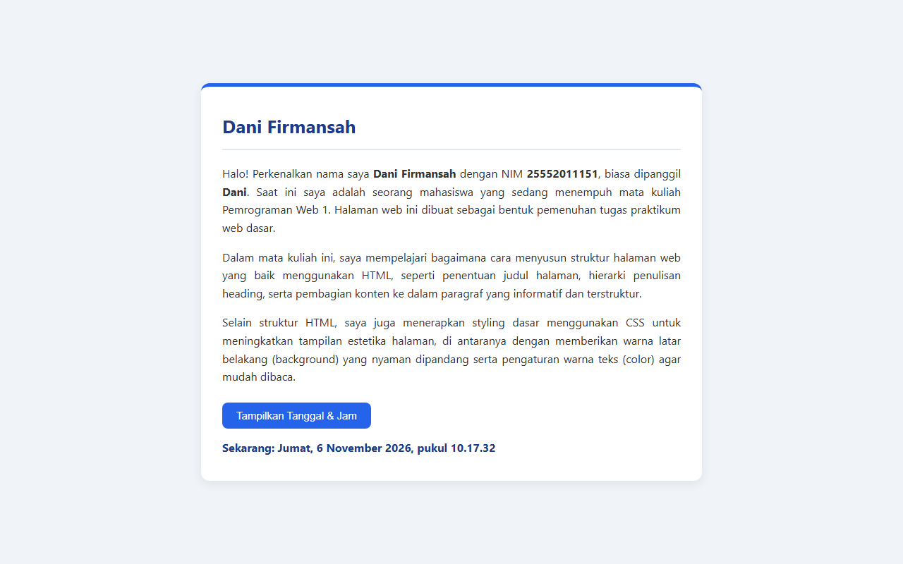

# Tugas 2 — Pemrograman Web 1

**Nama:** Dani Firmansah
**NIM:** 25552011151

Website satu halaman (satu file `index.html`) berisi perkenalan diri, dibuat dengan HTML, CSS, dan JavaScript tanpa library.

## Isi halaman

| Syarat | Implementasi |
| --- | --- |
| Judul halaman (nama mahasiswa) | `<title>Dani Firmansah</title>` |
| Minimal 3 paragraf + 1 heading | 1 `<h1>` dan 3 `
` berisi perkenalan |
| 1 elemen desain | Warna background `#f0f4f8`, warna teks `#333333`, kartu putih dengan aksen biru |
| Interaksi JavaScript | Tombol **"Tampilkan Tanggal & Jam"** yang menampilkan hari, tanggal, dan jam saat ini ke halaman |

## Cara menjalankan

Buka file `index.html` langsung di browser (klik dua kali file-nya).

## Screenshot

### Tampilan awal

### Setelah tombol diklik

